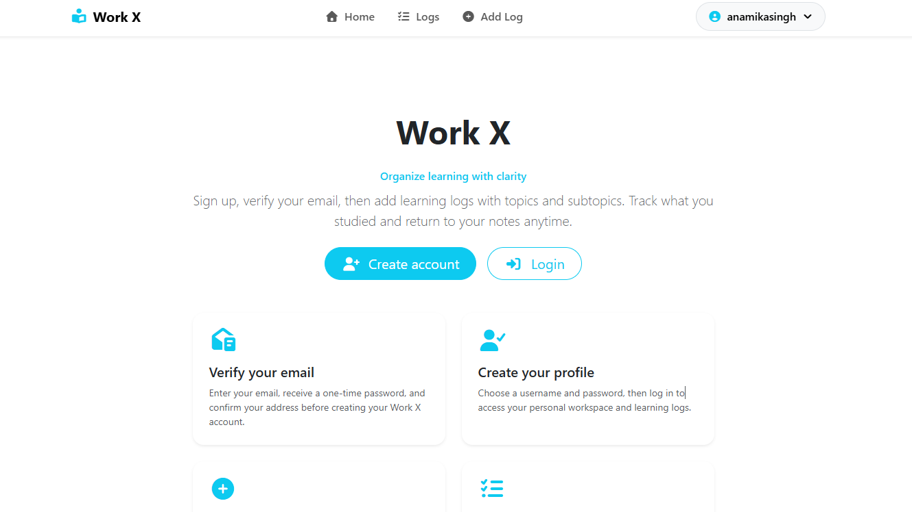

# WorkX
An Express.js and EJS-powered simple web applicatin to organize topics, track progress, and build a consistent learning habit.


## 🎨Features 
- User authentication with signup, login, and logout
- Email verification using OTP before completing signup
- OTP expiration after 10 minutes
- MongoDB-backed session storage
- Personal learning log dashboard for each authenticated user
- Create new logs with multiple topics and subtopics
- Edit existing logs and update topics
- Delete logs, topics, or subtopics
- Owner-based access control so users only manage their own logs
- Client-side validation for signup/login forms
- Flash-style success/error messaging across pages
- Bootstrap + EJS UI with reusable navbar/footer layout
- Topic normalization utility to clean submitted log data before save


## 💻Technologies Used
- Node.js — server-side runtime
- Express — web framework
- MongoDB via mongoose — database 
- EJS + ejs-mate — view templates
- Passport + passport-local + passport-local-mongoose — authentication
- express-session + connect-mongo — session management with MongoDB storage
- nodemailer — email sending for OTP verification
- dotenv — environment variable configuration
- cookie-parser — cookie handling
- method-override — support PUT/DELETE in forms
- Javascript
- CSS
- HTML5
- Bootstrap 

## 📦Installation 
1. Clone the repository
```bash
git clone https://github.com/iAnamikaSingh/WorkX.git
```

2. Navigate to the project directory
```bash
cd WorkX
```

3. Install dependencies
```bash
npm install
```
4. Install MongoDB Server
   https://www.mongodb.com/try/download/community
5. Start the application
```bash
nodemon index.js
```

6. Open your browser and visit
```bash
http://localhost:8000/
```

